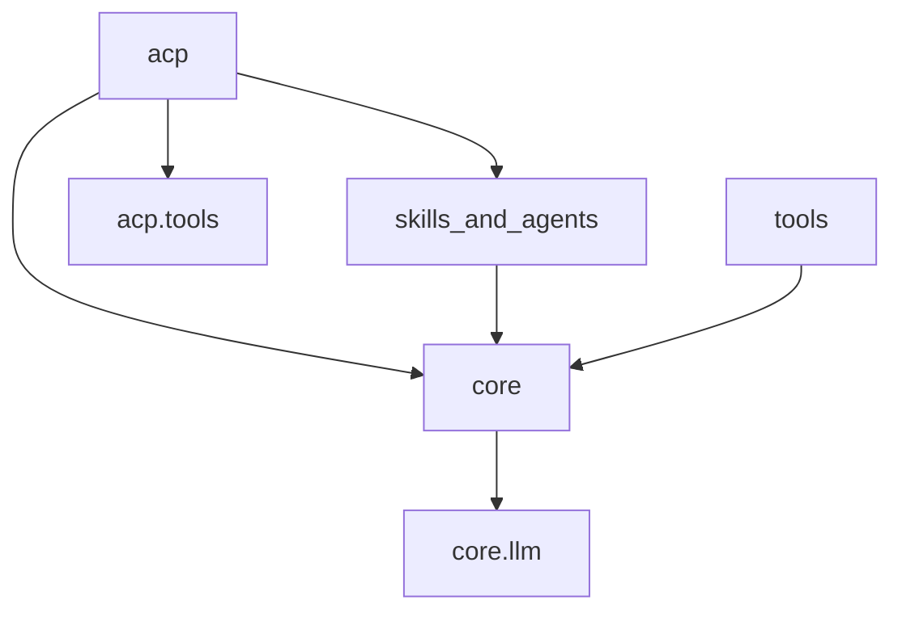

# Architecture

## Overview

```mermaid
flowchart LR
    App[Python application] -->|agent(...)| Core[core]
    App --> NativeTools[native tools]
    App --> SA[skills_and_agents]

    Client[ACP client] -->|JSON-RPC over stdio| ACP[acp]
    ACP --> Core
    ACP --> ACPTools[ACP-backed tools]
    ACP --> SA

    Core --> LLM[LLM providers]
    ACP --> Store[ACP session store]
```

## Packages

| Package | Responsibility |
|---|---|
| `quack_norris.core` | Stateless model/tool loop, context management, LLM facade and provider contracts |
| `quack_norris.tools` | Native file, shell and operation tools for direct SDK use |
| `quack_norris.skills_and_agents` | Persona/skill discovery, skill invocation, and management commands |
| `quack_norris.acp` | ACP protocol server, sessions, persistence, commands and ACP-backed tools |

## Dependency direction



`core` does not import ACP, discovery, storage, or user-interface code.

## State ownership

- `agent(...)` receives caller-owned history and mutates it during a turn.
- SDK hosts decide whether and how to persist history.
- ACP sessions own history, selected persona, skills, tools, working directory, context policy, and operation registry.
- ACP persistence stores metadata, core history, and replayable ACP updates under `QUACK_NORRIS_HOME/sessions/`.

## User interfaces

Quack Norris exposes an ACP agent, not a chat client. Editors, terminals, and other ACP clients provide rendering, filesystem/terminal callbacks, permissions, and elicitation.
