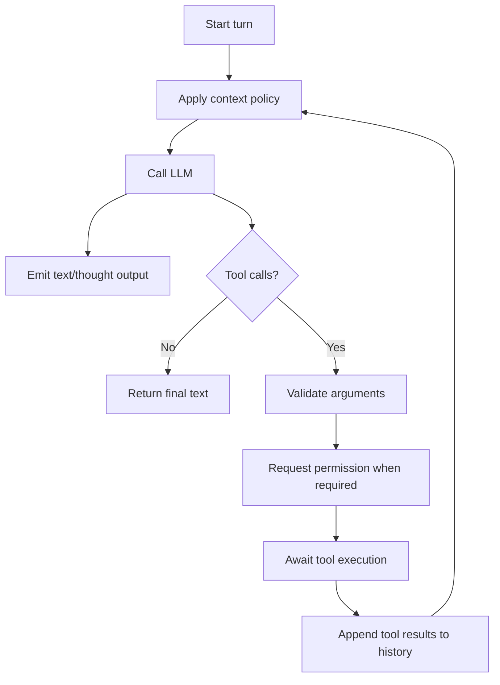

# Core

## Agent function

The public agent engine is the stateless async function `quack_norris.core.agent`:

```python
result = await agent(
    model=model,
    system_prompt=system_prompt,
    tools=tools,
    chat_history=history,
    on_permission_request=approve,
    on_output=handle_output,
    context=context_policy,
    skills=skills,
)
```

The caller supplies every runtime dependency. The core does not add tools or persist sessions.

## Turn loop



The loop supports cancellation, empty-response nudging, bounded iterations, output truncation, and normalized provider errors.

## Inputs

- model name;
- static or callable system prompt;
- exact tool list;
- mutable chat history;
- permission callback;
- output callback;
- optional context policy;
- optional `SkillInfo` list.

## Skill catalog

When skills are supplied, the core appends a deterministic catalog containing only skill names and compact descriptions to the effective system prompt. Full instructions are loaded through a caller-supplied skill tool.

Descriptions are normalized to one line and sorted case-insensitively for stable prompt caching.

## Output types

- `TextOutput` and `ThinkingOutput`;
- `ToolCallOutput` and `ToolResultOutput`;
- `MessageEnd` and `NudgeOutput`;
- `CheckpointOutput`;
- `ErrorOutput`.

## Context management

`core.context` measures the prompt, tool schemas, and history before every LLM call. It can:

- redact old tool results;
- cap individual tool results;
- spill oversized native results through a host-provided sink;
- summarize old history into checkpoints;
- preserve assistant/tool-result boundaries.

Token measurement currently uses a stable character-based approximation.
