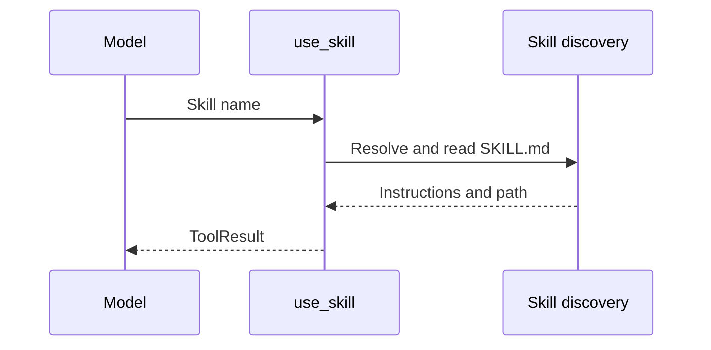

# Skills and Agents

## Package

`quack_norris.skills_and_agents` discovers personas and skills for runtime use and provides skill invocation. Installation and management are provided by a separate project.

```text
skills_and_agents/
  agent_discovery.py
  skill_discovery.py
  skill_invoke_tool.py
```

## Agent personas

Discovery locations:

- `~/.agents/agents/*.agent.md`;
- `<cwd>/.agents/agents/*.agent.md`;
- well-known project instructions including `CLAUDE.md`, `.github/copilot-instructions.md`, `.github/agents/*.md`, `.cursor/rules`, and `.cursorrules`.

Project definitions override global definitions with the same name. Frontmatter is stripped before the body becomes the system prompt.

## Skills

Discovery locations:

- `~/.agents/skills/<name>/SKILL.md`;
- `<cwd>/.agents/skills/<name>/SKILL.md`.

Project skills override global skills. Discovery returns compact `SkillInfo` values and resolved source paths. Descriptions come from frontmatter or the first body line and are normalized/capped for prompt efficiency.

## Skill invocation

`make_skill_invoke_tool(project_root)` creates the `use_skill` model tool. It loads full instructions by name and returns them as a non-truncatable tool result with the resolved source path.


