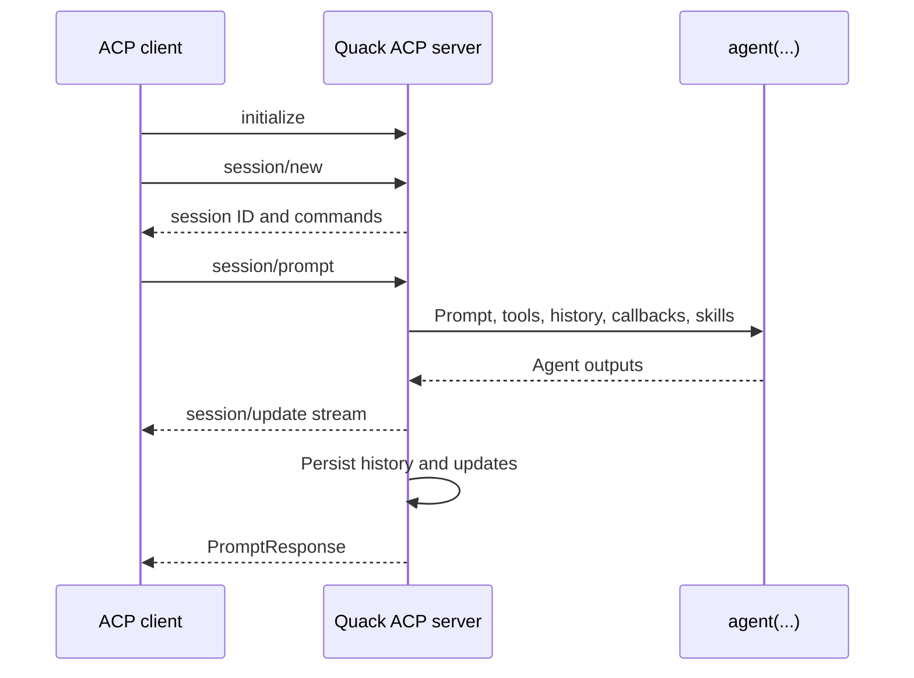

# ACP Server

## Start

```text
quack-norris acp [--config FILE]
```

The command runs `agent-client-protocol` 0.12.1 over JSON-RPC/stdio. Stdout is reserved for protocol traffic; logs use stderr.

## Capabilities

Implemented agent methods:

- initialize;
- session new;
- prompt;
- cancel;
- paginated session list with optional CWD filtering;
- durable session load with historical update replay.

New/load responses expose agent personas both as ACP session modes and as an `agent` select config option for clients that only render config controls. Models are exposed as a select config option with category `model`. Clients can call `session/set_mode` or `session/set_config_option`.

Static configured model lists are included immediately. Dynamic OpenAI-compatible and authenticated GitHub Copilot groups are queried through their `/models` API once after setup (with a five-second timeout per provider); discovered IDs are prefixed with their configured group. Copilot discovery uses an existing cached token and does not start device authentication. `/refresh` reloads the same LLM configuration source, repeats dynamic discovery, refreshes personas/skills, and emits updated config options without restarting the client.

Prompts are currently text-only. Image, audio, embedded context, MCP, session fork/resume/close, and elicitation are not advertised.

## Session lifecycle



## Persistence

Sessions are stored under:

```text
$QUACK_NORRIS_HOME/sessions/<32-character-session-id>/
  meta.json
  history.json
  updates.jsonl
```

- Session IDs are validated before any path access.
- After the first completed turn, a short title is generated with the configured summarizer model or session model, cleaned, persisted, and emitted through ACP `SessionInfoUpdate`; a prompt excerpt is used as fallback.
- Metadata/history writes use temporary-file replacement.
- `session/load` restores core history, rebuilds capability-dependent tools, and replays saved ACP updates before returning.
- Active terminal handles are not persisted across process restarts.

## Commands

The server advertises:

| Command | Purpose |
|---|---|
| `/skills` | List discovered skills |
| `/skill <name> [task]` | Apply a skill as explicit context for one turn |
| `/refresh` | Reload LLM configuration, dynamic models, personas, skills, and tools |

Model-driven skill use remains available through `use_skill`.

## Client-backed tools

The ACP server builds the exact tool list from negotiated client capabilities. The shell tool is named `pwsh` on Windows and `bash` elsewhere. Tool-call titles include the command (for example, `pwsh: echo "hello world"`), and file writes/replacements publish ACP diff content for supporting clients. It maintains a per-session operation registry that maps Quack operation IDs to ACP terminal IDs and guarantees terminal release on await, kill, cancellation, and file-operation completion.

Permission-required core tool calls are translated to ACP `request_permission` options. Unsupported capabilities result in omitted tools rather than local fallback behavior.

## Approval persistence

Permission requests offer allow once, project/global exact rules, project/global command-family rules for shell tools, and reject once. Project rules are stored in `<cwd>/.quack-whitelist.yaml`; global rules are stored in `$QUACK_NORRIS_HOME/whitelist.yaml`. Persisted approval never bypasses workspace/path validation.

## Provider configuration

The ACP launcher initializes the normal LLM configuration from `~/.config/quack-norris/config.yaml`, project configuration, or `--config FILE`. The selected default model is stored with each session.
